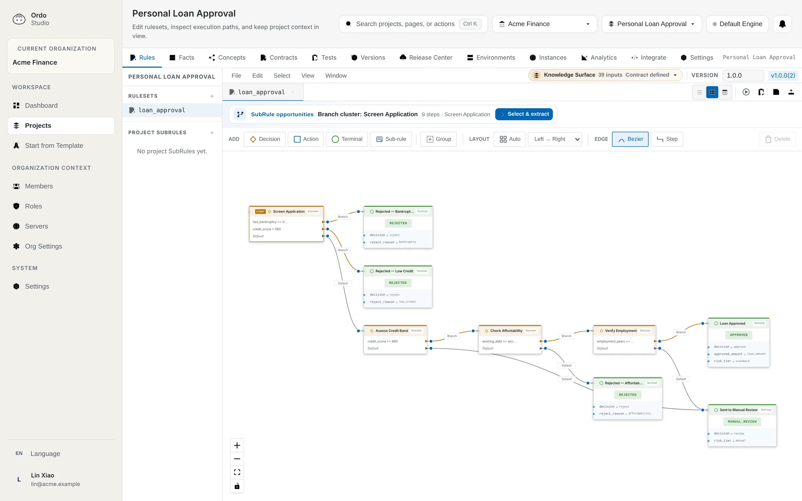
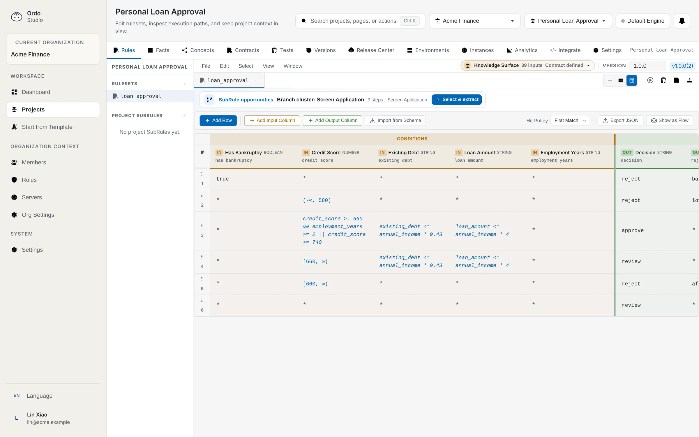
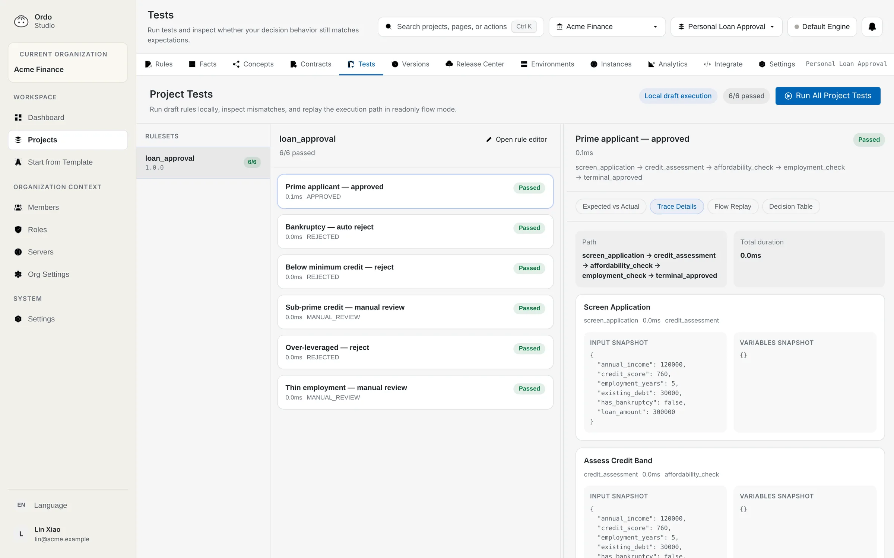

<p align="center">
  
</p>

<h1 align="center">Ordo</h1>

<p align="center">
  <strong>Turn judgments into decisions.</strong>
</p>

<p align="center">
  An open-source decision engine. Models and scores tell you what is going on. Ordo decides what to do about it,<br />
  with rules that have tests and versions, and shows which decisions a change moves before you ship it.
</p>

<p align="center">
  <a href="https://docs.ordoengine.com/en/"></a>
  <a href="https://www.npmjs.com/package/@ordo-engine/cli"></a>
  
  
  <a href="https://discord.gg/Y529FkArhh"></a>
</p>

<p align="center">
  English · <a href="README.zh.md">简体中文</a> · <a href="https://ordoengine.com/en/">Website</a> · <a href="https://docs.ordoengine.com/en/guide/quick-start">Quick start</a>
</p>

<p align="center">
  
</p>

---

## Every app that uses a decision model has a 0.85 in it

```python
if jev.confidence > 0.85:
    refund(order)
```

That line decides who gets money back. Someone wrote it once, nobody reviews it, and no test covers it. When the model is updated, 0.85 starts to mean something else, and nobody notices.

Decision models like [Jev](https://typesafe.ai) are good at reading a customer's message and answering "is this a refund request?" with a confidence. They don't know your refund window, your amount limits, or how sure is sure enough to pay out without a person looking. That part is a decision, and it is what Ordo is for.

> Jev turns text into judgments. Ordo turns judgments into decisions.

The same goes for discounts, credit limits and risk thresholds, which usually end up as if/else branches spread across dozens of files. Ordo keeps all of these decisions in their own rule files:

- Rules are JSON or YAML, in git next to your code. You can review them and diff them.
- The expression language is bounded: no loops, no side effects. Rules written by people and rules written by AI can both be checked.
- Money is exact decimal. Inputs are declared with types, and bad input is rejected before any rule runs.
- Every ruleset carries its own tests. `ordo test` runs them locally and in CI, with no server.
- Your application asks one question, such as "what do we do with this refund request?", and stays the same when the rules change.

## Try it

```bash
npm i -g @ordo-engine/cli
git clone https://github.com/Ordo-Engine/Ordo
cd Ordo/examples/rule-packs/jev-routing

ordo test
ordo trace refund-routing --input '{"jev":{"intent":{"choice":"refund","confidence":0.72},
  "urgency":{"score":0.3},"chargeback":{"noul":0.02}},
  "order":{"amount":"129.00","days_since_delivery":1},"customer":{"refunds_90d":0}}'
```

```text
code:    LLM_DRAFT
message: An LLM drafts the reply, an agent approves it
output:  {
  "reason": "medium_confidence",
  "jev_confidence": 0.72,
  "priority": "normal"
}

path:    escalation -> intent -> priority -> route -> dispatch -> llm_draft
```

Jev's confidence that the customer wants a refund was 0.72. The rules say that is not enough to move money on its own, so an LLM drafts the reply and an agent approves it. `trace` lists every step a run took, so "why wasn't this refunded right away?" has an answer. The pack's `route.mjs` asks Jev for you, and uses stored example answers when no API key is set.

## See what a change affects

Support is swamped, and someone proposes auto refunding from 0.80 instead of 0.85. After the edit, all 12 tests still pass. `ordo impact` runs the edit next to the last commit, over the test cases, real inputs you provide and probe inputs on both sides of every threshold:

```text
$ ordo impact refund-routing
impact refund-routing  (HEAD → working tree)
  309 inputs: 12 tests, 0 captured, 297 boundary probes

  LLM_DRAFT → AUTO_REFUND  18 inputs
  LLM_DRAFT → HUMAN_REVIEW  3 inputs

CHANGED probe:jev.intent.confidence=0.84  {... "order":{"amount":"129.00",
        "days_since_delivery":1} ...}
    code: LLM_DRAFT → AUTO_REFUND
    message: "An LLM drafts the reply, an agent approves it" → "Refund issued without review"
…
21 changed · 288 unchanged
```

The tests did not notice, but 18 inputs that used to wait for a person now get their money back without anyone reading the message. Run it with `--inputs last-week.jsonl` and the count is real customers, before the change ships.

Add `--fail-on-change` to stop surprise changes in CI, or `--json` to feed the result to other tools. Coding agents get the same check through `ordo mcp`, so an agent can look at the effect of its own rule edit before a person reviews it.

`ordo impact` needs CLI 0.7.0 or later ([release](https://github.com/Ordo-Engine/Ordo/releases/tag/cli-v0.7.0)). See the [CLI docs](https://docs.ordoengine.com/en/platform/cli).

## Put Ordo in front of Jev

ordo-server can sit between your application and Jev. Your code keeps calling Jev, and each answer comes back with Ordo's decision attached. Every call also goes to a decision log that `ordo impact --inputs` reads.

```bash
docker run -p 8080:8080 -e ORDO_DECIDE_API_KEY=<your OpenRouter key> \
  ghcr.io/ordo-engine/ordo:latest \
  --rules-dir /app/rule-packs/jev-routing/rulesets \
  --decide-upstream https://openrouter.ai/api

# from examples/rule-packs/jev-routing
curl localhost:8080/systemone/v1/systemone \
  -H 'content-type: application/json' -d @request.json
```

The response is Jev's answer plus an `ordo` field with the decision (`code`, `message`, `output`). In your application, set `TYPESAFE_BASE_URL=http://localhost:8080/systemone` and add the `ordo` field with your ruleset and order facts. See the [decision model gateway docs](https://docs.ordoengine.com/en/platform/decision-gateway).

## Rule packs

Common business decisions, already written and tested. Copy one and change the numbers to your own policy.

| pack | decides |
|------|---------|
| [jev-routing](examples/rule-packs/jev-routing) | what to do with a refund request after Jev has read the customer's message |
| [credit-approval](examples/rule-packs/credit-approval) | approve, send to manual review, or decline a personal loan |
| [promo-stacking](examples/rule-packs/promo-stacking) | which promotions apply at checkout, how far they stack, and what the customer pays |
| [fraud-scoring](examples/rule-packs/fraud-scoring) | allow, challenge or block a card payment |

A rule pack is a plain Ordo project. Rules your team writes can be shared the same way.

## Run the rules where the decision is made

```bash
# ordo-server, over HTTP or gRPC
docker run -p 8080:8080 ghcr.io/ordo-engine/ordo:latest
curl localhost:8080/api/v1/execute/<ruleset> \
  -H 'content-type: application/json' -d '{"input": {...}}'

# Embedded in a Rust program
cargo add ordo-core --git https://github.com/Ordo-Engine/Ordo

# In the browser, as WASM
npm install @ordo-engine/wasm
```

From your services, call the HTTP or gRPC API. Client SDKs for Go, Python and Java are in [`sdk/`](sdk) and are not on the package registries yet.

The engine is written in Rust: a bytecode VM, plus a Cranelift JIT for hot numeric expressions. A rule run takes 1.63 µs on the VM, numeric expressions take 50–80 ns after JIT, and a single HTTP thread serves about 54k QPS. See the [benchmarks](https://ordoengine.com/en/benchmarks).

## Studio

Studio draws the same rules as a flow and as a decision table, so people who don't write code can read the logic, run tests and request releases. Engineers keep working with files and git, and the CLI pushes and pulls between the two.

<table>
  <tr>
    <td width="50%"></td>
    <td width="50%"></td>
  </tr>
</table>

- One ruleset, shown as a flow or as a decision table
- Run tests in Studio and compare expected and actual results
- Field catalog, decision contracts, version history and release approvals

See the [Studio docs](https://docs.ordoengine.com/en/platform/studio).

## Ordo Guard

The same engine also keeps coding agents in bounds. Before Claude Code, Codex CLI or Cursor runs a command, it goes through your local rules: allow, deny, or ask you first.

```bash
npx @ordo-engine/cli guard init
```

The policy is an Ordo project in `.ordo-guard/`, with tests (`ordo guard test`) and a log (`ordo guard log`). See the [Guard docs](https://docs.ordoengine.com/en/platform/guard).

<p align="center">
  
</p>

## Compared with other engines

| | **Ordo** | OPA | Drools | json-rules-engine |
|---|---|---|---|---|
| JIT compilation | ✅ Cranelift | ❌ | ❌ | ❌ |
| Authoring model | Rule files (JSON/YAML), visual flow and decision table | Rego policy code | DRL / DMN + Business Central | JSON rule DSL |
| Built-in web workbench | ✅ Studio | Playground / APIs | ✅ Business Central | ❌ |
| Browser / Wasm target | ✅ Native | ✅ Policy-to-Wasm | ❌ | ✅ Browser JS |
| Deployment | Single binary or hosted platform | Binary, sidecar, or service | JVM app, KIE Server, Business Central | JS library for Node/browser |

The comparison covers first-party documented authoring and deployment capabilities, not cross-project benchmark claims.

## Project structure

```
ordo/
├── crates/
│   ├── ordo-core/       # Rule engine, bytecode VM, JIT compiler
│   ├── ordo-server/     # HTTP / gRPC API server
│   ├── ordo-platform/   # Orgs, projects, releases, testing
│   ├── ordo-cli/        # CLI: init, validate, test, trace, impact, mcp, guard
│   ├── ordo-wasm/       # WebAssembly bindings
│   ├── ordo-proto/      # gRPC definitions
│   └── ordo-derive/     # TypedContext derive macro
├── ordo-editor/
│   ├── packages/        # @ordo-engine/editor-{core,vue,react,wasm}
│   └── apps/
│       ├── studio/      # Studio (Vue 3 + TDesign)
│       ├── playground/  # Live demo
│       └── docs/        # Documentation site
├── examples/
│   └── rule-packs/      # jev-routing, credit-approval, promo-stacking, fraud-scoring
└── sdk/                 # Go / Python / Java clients
```

## License

MIT. See [LICENSE](LICENSE).

<p align="center"><sub><a href="https://ordoengine.com/en/">Website</a> · <a href="https://docs.ordoengine.com/en/">Docs</a> · <a href="https://discord.gg/Y529FkArhh">Discord</a></sub></p>
