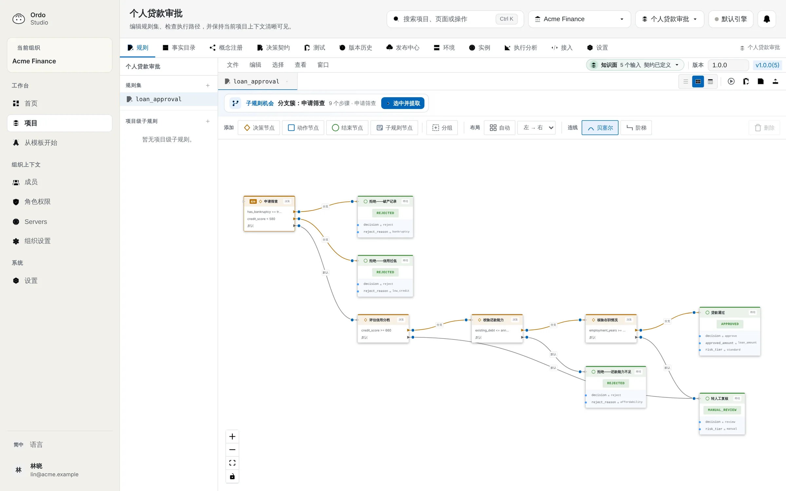
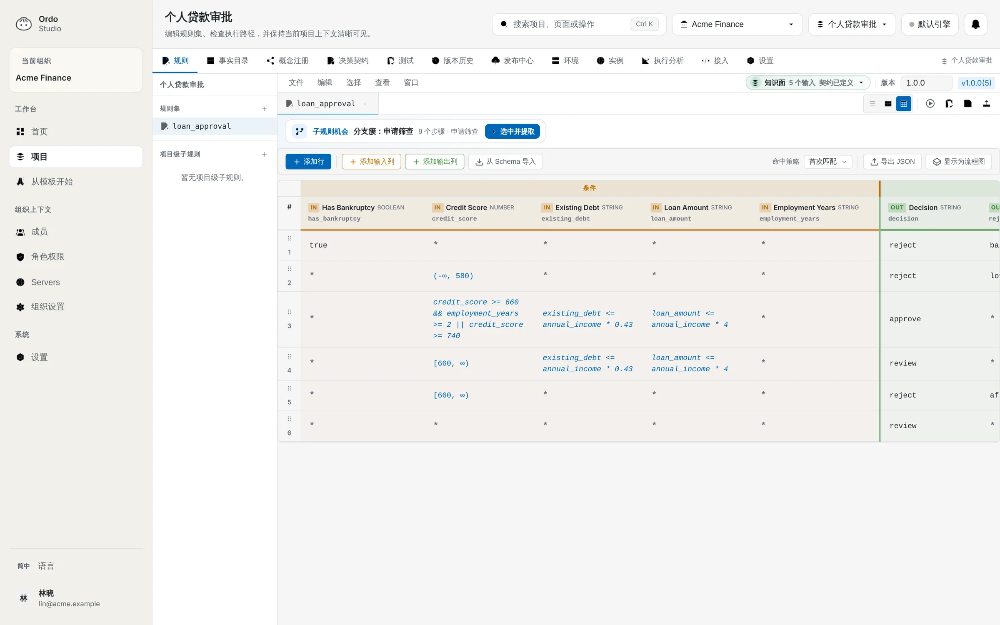
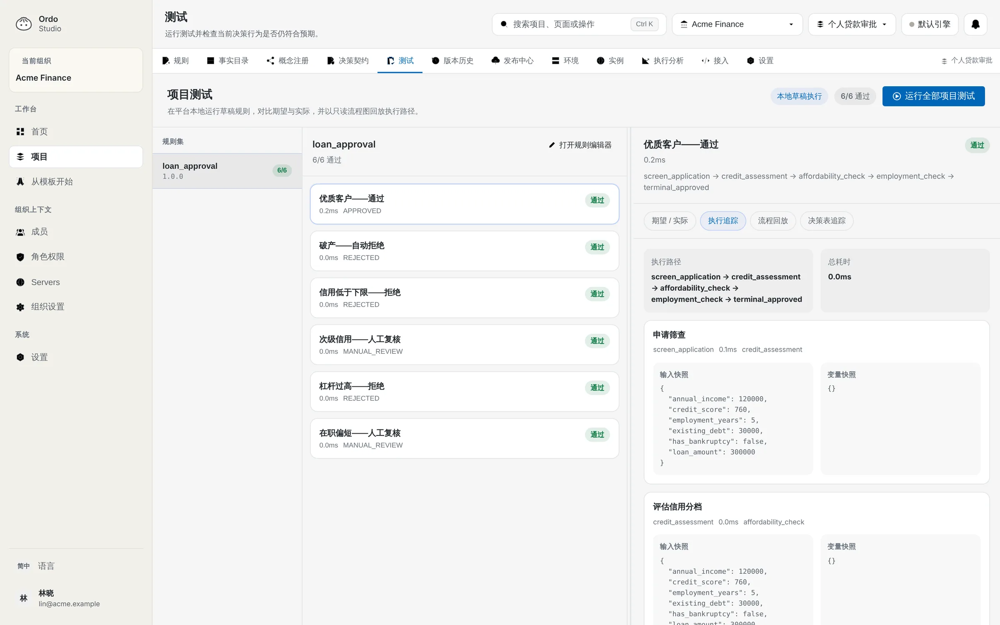

<p align="center">
  
</p>

<h1 align="center">Ordo</h1>

<p align="center">
  <strong>把判断变成决策。</strong>
</p>

<p align="center">
  开源决策引擎。模型和评分告诉你发生了什么，Ordo 决定接下来怎么做。<br />
  规则带测试、带版本，改之前先看会影响哪些决策。
</p>

<p align="center">
  <a href="https://docs.ordoengine.com/zh/"></a>
  <a href="https://www.npmjs.com/package/@ordo-engine/cli"></a>
  
  
  <a href="https://discord.gg/Y529FkArhh"></a>
</p>

<p align="center">
  <a href="README.md">English</a> · 简体中文 · <a href="https://ordoengine.com/">官网</a> · <a href="https://docs.ordoengine.com/zh/guide/quick-start">快速上手</a>
</p>

<p align="center">
  
</p>

---

## 每一个用决策模型的应用里，都藏着一个 0.85

```python
if jev.confidence > 0.85:
    refund(order)
```

这一行在决定谁能拿回钱。它是某个工程师随手写的，没人 review，也没有测试。模型一升级，0.85 的含义就变了，没有人会发现。

[Jev](https://typesafe.ai) 这类决策模型很擅长读懂客户的一段话，回答"这是不是退款请求"，并给出一个置信度。但它不知道你们的退款期限、金额上限，也不知道多大把握才敢不经人工直接退钱。这一步是决策，正是 Ordo 要做的事。

> Jev 把文字变成判断，Ordo 把判断变成决策。

折扣、额度、风控阈值也一样，通常是散在几十个文件里的 if/else。Ordo 把这些决策都放进单独的规则文件：

- 规则是 JSON 或 YAML，和代码一起进 git，可以 review，可以 diff。
- 表达式语言有边界：没有循环，不能改外部状态。人写的规则和 AI 写的规则都能被校验。
- 金额用 decimal 精确计算。输入字段先声明类型，传错了在规则执行之前就会被拒绝。
- 每个规则集带自己的测试。`ordo test` 在本地和 CI 里都能跑，不需要启动服务。
- 业务代码只需要问一句"这个退款请求怎么处理"，规则怎么变，这句代码都不用动。

## 什么时候值得用

如果判断逻辑只有一个人在写、在改，代码也有测试，Ordo 帮得不多，算是锦上添花。

下面这些情况，它才是刚需：

- 门槛经常改，改的人不是写代码的人。
- 同一个判断散在好几处，数字已经对不上了，比如一处写 0.7，另一处写 0.75。
- 模型会升级，升级之前要知道哪些决定会变。
- 决定会退钱、放款、拦下付款。出了错，要能说清是哪条规则、为什么。

## 跑起来看看

```bash
npm i -g @ordo-engine/cli
git clone https://github.com/Ordo-Engine/Ordo
cd Ordo/examples/rule-packs/jev-routing

ordo test
ordo trace refund-routing --input '{"jev":{"intent":{"choice":"refund","confidence":0.97},
  "urgency":{"score":0.43},"chargeback":{"noul":0.04}},
  "order":{"amount":"129.00","days_since_delivery":1},"customer":{"refunds_90d":0}}'
```

```text
code:    AUTO_REFUND
message: Refund issued without review
output:  {
  "amount": 129,
  "jev_confidence": 0.97,
  "priority": "normal"
}

path:    escalation -> intent -> priority -> route -> dispatch -> auto_refund
```

这是 Jev 的真实回答。客户写的是"搅拌机比视频里吵很多，不确定要不要，我有什么选择？"客户只是在问问题，Jev 却有 0.97 的把握认为这是退款请求，于是规则没经过任何人就退了 129 欧。Jev 读文字很准，但它给的置信度不是概率，TypeSafe 自己也说没有通用的阈值。`trace` 把一次执行走过的每一步都打出来，有人问"为什么没人看就退款了"，可以直接回答，要修也是改一条能测试的规则。规则包里的 `route.mjs` 会帮你调用 Jev，没有 API key 时用录下来的真实答案。

## 改之前先看影响

客服忙不过来，有人提议把自动退款的门槛从 0.85 降到 0.80。改完之后，12 个测试全部通过。`ordo impact` 把这次改动和上一个提交放在一起跑，输入包括测试用例、你提供的真实输入，以及在每个阈值两侧自动生成的探测值：

```text
$ ordo impact refund-routing
impact refund-routing  (HEAD → working tree)
  309 inputs: 12 tests, 0 captured, 297 boundary probes

  LLM_DRAFT → AUTO_REFUND  18 inputs
  LLM_DRAFT → HUMAN_REVIEW  3 inputs

CHANGED probe:jev.intent.confidence=0.84  {... "order":{"amount":"129.00",
        "days_since_delivery":1} ...}
    code: LLM_DRAFT → AUTO_REFUND
    message: "An LLM drafts the reply, an agent approves it" → "Refund issued without review"
…
21 changed · 288 unchanged
```

测试没发现任何问题，但有 18 个原本要人确认的输入，现在没人看就直接退钱了。加上 `--inputs last-week.jsonl` 用上周的真实请求跑一遍，看到的就是真实客户的数量，而且是在改动上线之前。

加上 `--fail-on-change` 可以在 CI 里拦住意外的改动，`--json` 方便接到别的工具里。编码 Agent 通过 `ordo mcp` 调用同一个检查，改完规则先自己看一遍影响，再交给人 review。

`ordo impact` 需要命令行 0.7.0 或更新的版本，`--model` 和 `ordo decisions` 需要 0.8.0（[下载](https://github.com/Ordo-Engine/Ordo/releases/tag/cli-v0.8.0)）。详见 [CLI 文档](https://docs.ordoengine.com/zh/platform/cli)。

## 把 Ordo 放在 Jev 前面

ordo-server 可以放在应用和 Jev 之间。代码照常调用 Jev，每个回答返回时都会带上 Ordo 的决策，每次调用也会记进决策日志。

```bash
mkdir -p decisions && chmod 777 decisions   # 容器里的用户要往这里写日志
docker run -p 8080:8080 -e ORDO_DECIDE_API_KEY=<你的 OpenRouter key> \
  -v "$PWD/decisions:/decisions" \
  ghcr.io/ordo-engine/ordo:latest \
  --rules-dir /app/rule-packs/jev-routing/rulesets \
  --decide-upstream https://openrouter.ai/api \
  --decide-log-dir /decisions --decide-log-requests

# 在 examples/rule-packs/jev-routing 目录下
curl localhost:8080/systemone/v1/systemone \
  -H 'content-type: application/json' -d @request.json
```

返回的是 Jev 的回答，外加一个 `ordo` 字段，里面是决策（`code`、`message`、`output`）。在应用里设置 `TYPESAFE_BASE_URL=http://localhost:8080/systemone`，请求里加上 `ordo` 字段，写明规则集和订单信息就行。如果应用本来就把事实放在 JSON 格式的 `state` 里发给 Jev，代码一行都不用改：设置 `TYPESAFE_BASE_URL=http://localhost:8080/systemone/rulesets/<规则集>`，规则直接读 `state` 里的字段。`ordo decisions decisions/` 汇总都做了哪些决定。

换模型之前，把日志里的真实请求拿去问新模型，看哪些决定会变：

```text
$ ordo impact refund-routing --inputs decisions/decisions-2026-10-13.jsonl \
    --model cloudflare/clef-flash --repeat 3
  model: typesafe/jev-1.13-20260917 → cloudflare/clef-flash
  24 logged requests asked again, 3 times each

  AUTO_REFUND → ESCALATE  1 input
  AUTO_REFUND → LLM_DRAFT  3 inputs
  HUMAN_REVIEW → ESCALATE  1 input
  ROUTE_TEAM → HUMAN_REVIEW  2 inputs
```

规则一条没改，只是换了模型，24 个请求里就有 7 个换了处理方式。一位嫌夹克太小想退货的客户，问三次有两次会被当成要发起拒付，转给资深客服。详见[决策模型网关文档](https://docs.ordoengine.com/zh/platform/decision-gateway)。

## 规则包

常见的业务决策已经写好，带测试。拷过去，把数字改成你们自己的政策。

| 规则包 | 决定什么 |
|------|---------|
| [jev-routing](examples/rule-packs/jev-routing) 退款分流 | Jev 读完客户消息之后，这个退款请求怎么处理 |
| [credit-approval](examples/rule-packs/credit-approval) 信贷审批 | 个人贷款申请：通过、转人工审核，或者拒绝 |
| [promo-stacking](examples/rule-packs/promo-stacking) 优惠叠加 | 结账时哪些优惠生效，叠加后最多减多少，最后付多少 |
| [fraud-scoring](examples/rule-packs/fraud-scoring) 支付风控评分 | 一笔卡支付：放行、加一道验证，或者直接拦截 |

规则包就是普通的 Ordo 项目。你们自己写好的规则，也可以用同样的方式分享出去。

## 在需要做决策的地方执行

```bash
# ordo-server，走 HTTP 或 gRPC
docker run -p 8080:8080 ghcr.io/ordo-engine/ordo:latest
curl localhost:8080/api/v1/execute/<ruleset> \
  -H 'content-type: application/json' -d '{"input": {...}}'

# 嵌入 Rust 程序
cargo add ordo-core --git https://github.com/Ordo-Engine/Ordo

# 在浏览器里，以 WASM 运行
npm install @ordo-engine/wasm
```

业务服务通过 HTTP 或 gRPC 接口调用。Go、Python、Java 的客户端 SDK 在 [`sdk/`](sdk) 目录里，还没有发布到各自的包仓库。

引擎用 Rust 编写：字节码虚拟机，加上给数值表达式用的 Cranelift JIT。字节码执行一次规则 1.63 µs，JIT 编译后的数值表达式 50–80 ns，HTTP 单线程大约 54k QPS。详见[基准测试](https://ordoengine.com/benchmarks)。

## Studio

Studio 把同一份规则画成流程图和决策表。不写代码的同事可以在这里读逻辑、跑测试、提发布。研发继续用文件和 git，命令行在两边之间推拉同步。

<table>
  <tr>
    <td width="50%"></td>
    <td width="50%"></td>
  </tr>
</table>

- 同一份规则，流程图和决策表两种视图
- 在 Studio 里直接跑测试，对比期望和实际结果
- 字段目录、决策契约、版本历史和发布审批

详见 [Studio 文档](https://docs.ordoengine.com/zh/platform/studio)。

## Ordo Guard

同一个引擎，也能管住编码 Agent。Claude Code、Codex CLI 或 Cursor 每次执行命令之前，先过一遍本地规则：放行、拒绝，或者先问你。

```bash
npx @ordo-engine/cli guard init
```

策略本身是 `.ordo-guard/` 里的一个 Ordo 项目，有测试（`ordo guard test`），有日志（`ordo guard log`）。详见 [Guard 文档](https://docs.ordoengine.com/zh/platform/guard)。

<p align="center">
  
</p>

## 和其他引擎比较

| | **Ordo** | OPA | Drools | json-rules-engine |
|---|---|---|---|---|
| JIT 编译 | ✅ Cranelift | ❌ | ❌ | ❌ |
| 编写方式 | 规则文件（JSON/YAML）、流程图和决策表 | Rego 策略代码 | DRL / DMN + Business Central | JSON 规则 DSL |
| 内置 Web 工作台 | ✅ Studio | Playground / API | ✅ Business Central | ❌ |
| 浏览器 / Wasm | ✅ 原生支持 | ✅ Policy-to-Wasm | ❌ | ✅ 浏览器 JS |
| 部署方式 | 单个二进制或托管平台 | 二进制、sidecar 或服务 | JVM 应用、KIE Server、Business Central | Node/浏览器 JS 库 |

这里只比较各项目官方文档里写明的编写和部署能力，不涉及跨项目的性能对比。

## 目录结构

```
ordo/
├── crates/
│   ├── ordo-core/       # 规则引擎、字节码虚拟机、JIT 编译器
│   ├── ordo-server/     # HTTP / gRPC 服务
│   ├── ordo-platform/   # 组织、项目、发布、测试
│   ├── ordo-cli/        # 命令行：init、validate、test、trace、impact、mcp、guard
│   ├── ordo-wasm/       # WebAssembly 绑定
│   ├── ordo-proto/      # gRPC 定义
│   └── ordo-derive/     # TypedContext 派生宏
├── ordo-editor/
│   ├── packages/        # @ordo-engine/editor-{core,vue,react,wasm}
│   └── apps/
│       ├── studio/      # Studio（Vue 3 + TDesign）
│       ├── playground/  # 在线演示
│       └── docs/        # 文档站
├── examples/
│   └── rule-packs/      # 退款分流、信贷审批、优惠叠加、支付风控评分
└── sdk/                 # Go / Python / Java 客户端
```

## 许可

MIT，见 [LICENSE](LICENSE)。

<p align="center"><sub><a href="https://ordoengine.com/">官网</a> · <a href="https://docs.ordoengine.com/zh/">文档</a> · <a href="https://discord.gg/Y529FkArhh">Discord</a></sub></p>
